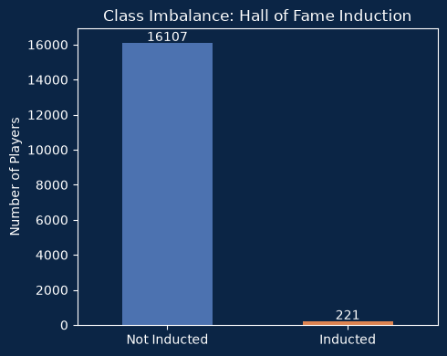
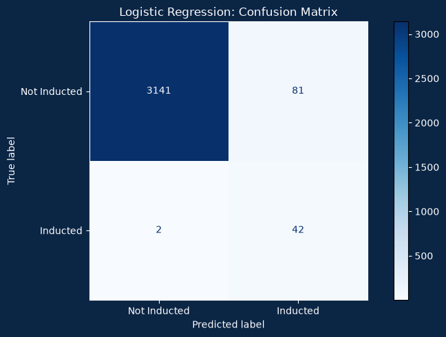
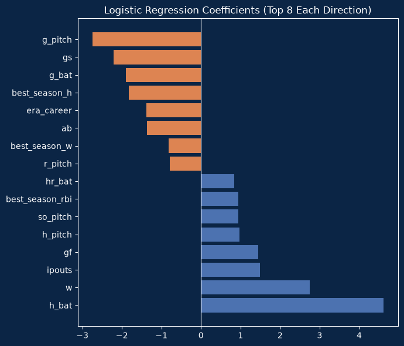

# Predicting Baseball Hall of Fame Induction

A data wrangling and machine learning project that predicts whether an MLB player will ever be inducted into the Baseball Hall of Fame, using only career batting and pitching statistics.

Built for the Data Wrangling module, Diploma in Data Science, Ngee Ann Polytechnic.

**Tools:** Python, pandas, NumPy, scikit-learn, SciPy, Matplotlib, Seaborn

## The problem

Hall of Fame induction is rare. Of the 16,328 eligible players in this dataset, only 221 (about 1.3%) were inducted. This is a **binary classification problem with severe class imbalance**, the same shape as many risk problems (for example fraud or loan default), where the event you care about is rare.

A model that always predicts "not inducted" scores about 99% accuracy but finds zero Hall of Famers, so I evaluated with **precision, recall and F1** instead of accuracy.

## Data

Four tables from the Baseball Databank (Lahman) dataset:

| Table | Grain | Rows |
|---|---|---|
| Player | one row per player | 18,846 |
| Batting | one row per player per season | 101,332 |
| Pitching | one row per player per season | 44,139 |
| HallOfFame | one row per player per ballot year | 4,120 |

The data files are **not included in this repository**. Download the tables from the [Baseball Databank](https://github.com/chadwickbureau/baseballdatabank), save them as `player.csv`, `batting.csv`, `pitching.csv` and `hall_of_fame.csv` in a `data/` folder, and check the column names match the notebook (it uses snake_case names such as `player_id`).

## Approach

1. **Wrangling multiple tables:** aggregated season-level batting and pitching to career totals (`groupby().sum()`) and single-season peaks (`.max()`), collapsed ballot-level Hall of Fame records to one yes/no per player, and merged on `player_id`. Dropped `era` and `baopp` before summing, because summing a rate is meaningless. Rebuilt a valid career ERA from summed earned runs and innings pitched. Checked for duplicate keys after merging.
2. **Cleaning:**
   - Filled structural missing values with 0 (for example a pitcher with no batting rows) and imputed height and weight with the training-set median.
   - Excluded 2,518 players who were still active or retired too recently to be eligible.
   - Kept outliers on purpose: the biggest outliers are the Hall of Fame careers the model is meant to find.
   - One-hot encoded categorical features and applied a log transform to skewed counting stats (for example the skew of career hits fell from 3.26 to 0.34).
3. **Feature engineering:** rate stats (batting average, home run rate, win percentage, career ERA), peak-season stats, career length bucket and a primary-role flag (batter / pitcher / two-way).
4. **Modelling:** stratified 80/20 split, then compared a naive baseline, logistic regression and a depth-limited decision tree, all with class weighting. Also tested RobustScaler, L1 regularisation and PCA.

## Results (test set, 44 inducted players out of 3,266)

| Model | Precision | Recall | F1 |
|---|---|---|---|
| Naive baseline (always "No") | 0.00 | 0.00 | 0.00 |
| **Logistic regression** | **0.34** | **0.95** | **0.50** |
| Decision tree (max depth 5) | 0.18 | 0.93 | 0.30 |
| Logistic regression + PCA (12 components) | 0.25 | 0.98 | 0.39 |

The logistic regression catches 95% of true Hall of Famers but also flags many players who were not inducted (precision 0.34). That trade-off suits a first-pass screening tool, where a missed candidate costs more than an extra name for a person to review.





## What I learned

- **Data leakage:** I originally imputed missing values using the whole dataset. I fixed it to use training-set medians only, which is the correct approach even though it did not change the headline metrics.
- **Bug found by checking:** my first `primary_role` feature found zero pitchers. Investigating showed that the batting table logs games even for pitchers who never batted (253 players), so I rebuilt the flag using at-bats.
- **Multicollinearity:** some logistic regression coefficients had signs that contradicted baseball logic (for example games pitched was strongly negative while wins were strongly positive). L1 regularisation and PCA showed the correlated features carry joint information for this rare class.

## Limitations and next steps

- Only 44 positive examples in the test set, so results vary between splits. Cross-validation would give a more reliable estimate.
- Adding rate and peak features improved logistic regression slightly (F1 0.49 to 0.50) but lowered the decision tree (0.48 to 0.30). This needs cross-validation to confirm.
- 247 players were inducted in the merged data but 221 remain after the eligibility filter, likely because of missing or unparseable `final_game` dates for some early players.
- Possible improvements: add award data (All-Star, MVP), fielding stats, and a missing-value indicator for height and weight.
- Hall of Fame voting also weighs character and reputation, so this model is a screening signal, not a replacement for the vote.

## How to run

```bash
pip install -r requirements.txt
# add the CSV files to a data/ folder (see Data section)
jupyter notebook baseball_hof_prediction.ipynb
```
